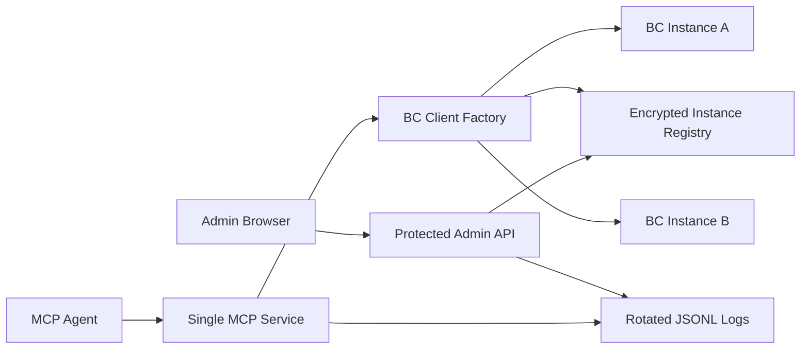

# JMX-QUERY MCP Server Architecture

## Purpose

JMX-QUERY MCP Server provides a single Model Context Protocol endpoint for multiple Business Central targets. It replaces the former one-environment, one-service model with a managed hierarchy:



A target is explicit in every Business Central tool call. The server never keeps mutable session-level target state.

## Data Model

### Instance

An `Instance` is a Business Central endpoint and authentication profile.

- `name`: globally unique operator and MCP-facing name.
- `description`: optional admin description.
- `enabled`: permits or rejects new requests.
- `authType`: `BASIC`, `NTLM`, `SSO`, or `OAUTH`.
- authentication fields: endpoint and credentials appropriate to the selected type.
- `timeoutMs`: per-Instance request timeout.
- `companies`: a collection of Company targets.
- timestamps and opaque UUID identifier.

For OAuth, `tenantId` is an Entra ID tenant identifier and is not a Business Central Company.

### Company

A `Company` is a selectable Business Central target nested under an Instance.

- `name`: unique alias within its Instance; agents pass this as `bcCompany`.
- `company`: exact technical Business Central OData Company value.
- `executionContextCode`: default JMX-QUERY execution context.
- `enabled`: permits or rejects new calls to the Company.
- timestamps and opaque UUID identifier.

### Public Projection

`toPublicInstance` removes `password` and `clientSecret` before data reaches Admin lists, MCP discovery, or logs. It returns only presence flags such as `hasPassword` and `hasClientSecret`.

## Encrypted Registry

`EncryptedInstanceRegistry` persists a versioned store at `INSTANCE_STORE_PATH`.

- AES-256-GCM encrypts the complete serialized registry.
- A key is derived from `INSTANCE_MASTER_KEY` using `scryptSync`.
- Every write creates a unique 12-byte IV and authentication tag.
- Writes use a temporary file then atomic rename.
- Authentication failure, corrupted ciphertext, and invalid schemas reject startup or access rather than silently accepting partial data.

The encrypted file and master key are a restore pair. Rotation of the master key must be handled as a controlled re-encryption operation; arbitrary replacement makes existing data unreadable.

## BC Client Lifecycle

`BcClientFactory` resolves enabled `(bcInstance, bcCompany)` names through the registry.

1. Reject unknown or disabled Instance/Company targets.
2. Cache one `BcClient` per Instance UUID.
3. Compare the cached revision with the Instance `updatedAt` timestamp.
4. Recreate the client and invalidate OAuth state when an Instance revision changes.
5. Pass the selected Company's technical `company` value to each OData action call.

A disabled target blocks new work. Existing calls retain their client and are allowed to finish.

## MCP Contract

The MCP server is created per transport connection because MCP SDK `connect()` binds a transport to that server instance. The shared registry, client factory, and log service are process-level dependencies.

`jmxq_listInstances` exposes enabled public Instance and Company names so an agent can discover valid targets. Every Business Central tool requires:

```json
{
  "bcInstance": "Production",
  "bcCompany": "Northwind"
}
```

Tools may include `executionContextCode`. When absent, the Company `executionContextCode` is used. The server must never default execution context from the technical `company` field.

MCP transports:

- Stdio for local process clients.
- SSE at `/mcp/sse` with messages at `/mcp/messages`.
- Streamable HTTP at `/mcp/stream` on the main service port or `MCP_STREAMABLE_PORT`.

HTTP MCP routes require `Authorization: Bearer <MCP_API_KEY>` when `MCP_API_KEY` is configured.

## Admin API and GUI

The Admin API is disabled unless `ADMIN_API_ENABLED=true`. Enabling it without `ADMIN_API_KEY` is a startup error.

All Admin routes use a bearer token checked with timing-safe comparison. The Admin GUI sends the key only in request headers and keeps it in React memory. It does not use `localStorage`, `sessionStorage`, or URL parameters.

Core route groups:

- Instance and Company CRUD.
- Instance and Company enable/disable.
- Password or Client Secret reveal.
- Connection test.
- Log query and metrics.
- Markdown documentation retrieval.

Secret reveal is a separate narrow endpoint. It accepts only `password` or `clientSecret`, requires normal bearer authentication plus a second `confirmAdminKey` value, sends `Cache-Control: no-store`, and returns exactly one secret value.

The static Admin UI is built by Vite to `admin-ui` and hosted by Fastify at `/admin`. The protected Documentation view fetches root `README.md` through `/admin/api/documentation`; raw HTML is not rendered by the Markdown client.

## Logging

`LogService` records structured events in daily JSONL files:

- target IDs and display names;
- tool name, outcome, duration, request ID, and execution context;
- sanitized error type and message;
- JMX-QUERY script only for `jmxq_executeScript`, limited by `LOG_SCRIPT_MAX_LENGTH`.

The service serializes writes, applies daily retention by `LOG_RETENTION_DAYS`, supports query filters and aggregate metrics, and retains in-memory subscribers for its events endpoint.

Logs must not include:

- passwords, Client Secrets, API keys, access tokens, or Authorization headers;
- raw Business Central responses;
- raw MCP argument payloads in general Pino logging.

The current Admin UI uses manual refresh. Native browser `EventSource` does not permit bearer headers, and API keys must not be moved to URL query parameters. A future live view needs an authenticated streaming design such as short-lived secure cookies or a fetch-based event parser with a carefully designed server contract.

## Windows Deployment

There is exactly one Windows service: `JMX-QUERY MCP Server`.

The service installer loads repository-root `.env`. That file contains only service network, key, storage, and logging configuration. Business Central details are never stored in service-specific environment files; they are created through the Admin GUI and persisted in `data/instances.enc`.

Runtime files:

| Path | Purpose |
| --- | --- |
| `.env` | Service configuration and keys; never commit. |
| `data/instances.enc` | Encrypted Instance and Company registry. |
| `logs/` | Rotated structured audit logs. |
| `admin-ui/` | Generated static Admin GUI served by Fastify. |

## Validation Strategy

Focused validation should cover:

1. Registry round trip, tamper detection, and wrong master-key failure.
2. Instance/Company enablement and uniqueness rules.
3. Admin authentication, secret reveal confirmation, and public redaction.
4. Factory routing, cache invalidation, and Company execution-context fallback.
5. MCP schemas requiring `bcInstance` and `bcCompany`.
6. Log redaction, rotation, retention, filtering, and metrics.
7. Static Admin GUI routing and protected Documentation retrieval.
8. A real connection test for each configured authentication type in the deployment environment.

The repository build compiles TypeScript and produces the Admin UI. Production connection tests require actual Business Central credentials and are intentionally not embedded in source-controlled tests.

## Operational Limits

- Log queries currently scan retained local JSONL files; this is appropriate for modest local audit volumes, not centralized high-volume observability.
- The GUI is an administrative surface, not a multi-user authorization system. Anyone holding `ADMIN_API_KEY` has administrative access.
- The service does not abort in-flight Business Central requests when an operator disables a target.
- The store master key is not recoverable from the encrypted registry.
